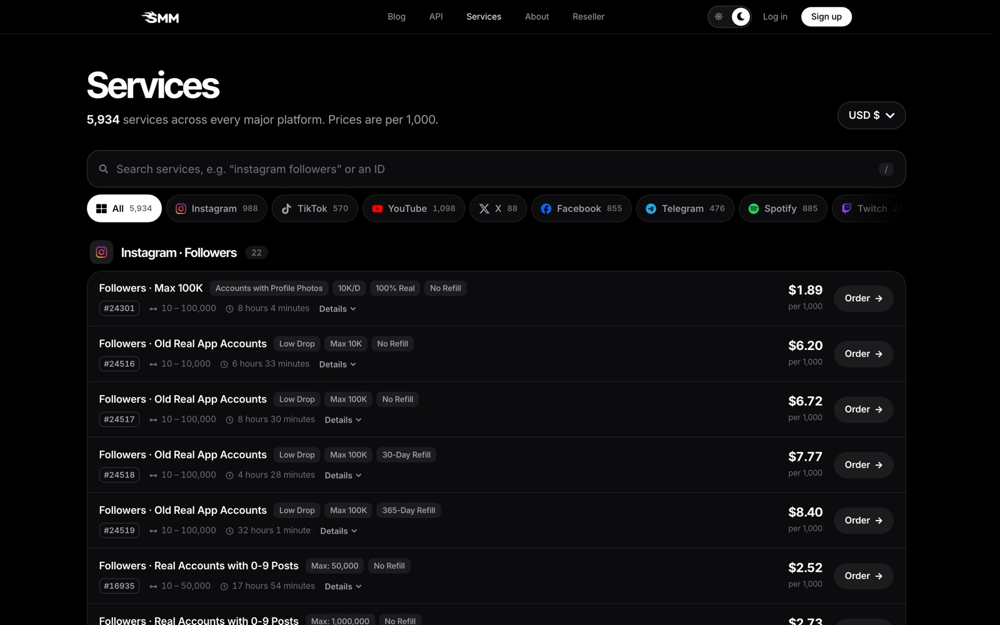

<div align="center">

# SMM Panel Telegram Bot

**Order and track Instagram, TikTok, YouTube and Telegram services from Telegram**, powered by the [SMM.GG](https://smm.gg) SMM panel API.

[](https://smm.gg)
[](https://smm.gg/api)
[](https://github.com/smm-gg/smm-panel-api)


</div>

<br>

A small, readable SMM panel bot in one Python file. Check your balance, search 5,900+ services, place orders, follow their status and request refills without opening the panel.

```
/balance                              Balance: 100.84 USD
/services instagram followers         #24301 Followers · Max 100K - $1.89/1000 ...
/order 24301 https://instagram.com/you 1000
                                      Order placed: #23501
/status 23501                         #23501: In progress · Remains: 420
/refill 23501                         Refill requested: #812
```

## Setup in 3 minutes

1. **Get an API key:** sign up at [smm.gg](https://smm.gg/signup) and copy your key from [smm.gg/account](https://smm.gg/account).
2. **Create a Telegram bot:** message [@BotFather](https://t.me/BotFather), send `/newbot` and copy the token.
3. **Find your Telegram user ID:** message [@userinfobot](https://t.me/userinfobot).
4. **Run it:**

```bash
git clone https://github.com/smm-gg/smm-panel-telegram-bot
cd smm-panel-telegram-bot
pip install -r requirements.txt

export SMMGG_API_KEY=your_api_key
export TELEGRAM_BOT_TOKEN=123456:ABC...
export ALLOWED_USER_IDS=123456789      # comma separated, only these users can order
python bot.py
```

The bot only answers the user IDs in `ALLOWED_USER_IDS`, so nobody else can spend your balance.

## Commands

| Command | What it does |
|---|---|
| `/balance` | Shows your SMM.GG balance |
| `/services <search>` | Finds services by name or category, with price per 1,000 and min/max |
| `/order <service_id> <link> <quantity>` | Places an order |
| `/status <order_id>` | Status, start count, remains and charge |
| `/refill <order_id>` | Requests a refill (services with refill only) |

<p align="center"><a href="https://smm.gg/services"></a><br><sub>Browse every service ID on <a href="https://smm.gg/services">smm.gg/services</a></sub></p>

## Ideas to build on

- **Sell to your own customers:** add prices with your markup and a balance per Telegram user.
- **Auto-order for new posts:** watch a channel and order views for every new post.
- **Drip-feed:** pass `runs` and `interval` to `smm("add", ...)` for services that support it.
- **Your own panel:** want a full website instead of a bot? Open *Your own panel* in your SMM.GG account.

More languages (PHP, Node.js) and the full action list: [smm-gg/smm-panel-api](https://github.com/smm-gg/smm-panel-api).

## Support

Questions about the API or an order: [smm.gg/tickets](https://smm.gg/tickets) (24/7).

<div align="center"><sub>SMM panel Telegram bot · SMM panel API · Instagram, TikTok, YouTube & Telegram services · MIT licensed</sub></div>
